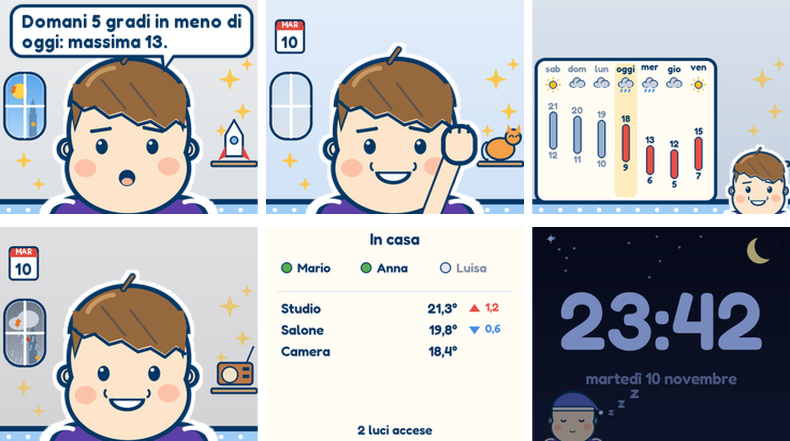
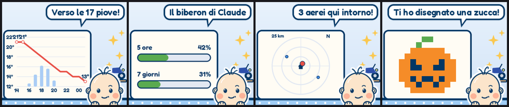
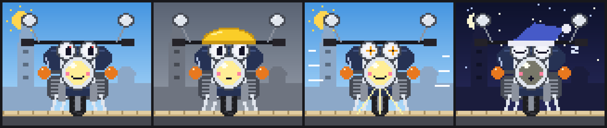

# smalltv-coinquilino

*Una faccia e una voce per il tuo Home Assistant: un personaggio su un cubetto da 15 euro che ti
racconta quello che la casa, il meteo e la giornata hanno da dire.*

[English](README.md) · **[Manuale completo](docs/manuale/README.md)**



Home Assistant sa tante cose della tua casa, ma parla con notifiche che nessuno legge.
**Coinquilino** gli dà un personaggio che vive in un GeekMagic SmallTV Ultra, il cubetto da mettere
su una mensola: mostra e dice quello che conta — qualcuno che sta tornando, il citofono a cui
nessuno ha risposto, domani cinque gradi in meno, pioggia alle quattro, un appuntamento fra un'ora,
una luce rimasta accesa a casa vuota — sul cubo, su Telegram e, se vuoi, a voce con un altoparlante
di Home Assistant.

È fatto come un'**estensione di Home Assistant**, non come un gadget chiuso:

- **Le tue automazioni decidono, il personaggio racconta.** Un solo evento, `coinquilino_say`, gli
  fa dire qualunque cosa da qualunque automazione o script, con regole semplici per la casa vuota, la
  notte e le ripetizioni. I **blueprint** pronti coprono i casi soliti: luci accese a casa vuota,
  clima spento con la finestra aperta, citofono, batterie scariche, aggiornamenti, qualcuno che sta
  tornando (Proximity), pacchi (17TRACK), raccolta dei rifiuti.
- **Legge quello che hai già**: persone e presenza, meteo, liste di cose da fare (Local To-do,
  quella di Alexa…), calendari, Workday, temperature delle stanze, consumi, sensori del consumo di
  Claude.
- **Ci puoi parlare**: da un aiutante Testo in plancia, da Telegram ovunque, da Siri e CarPlay con
  un comando rapido. Con il **server MCP** di Home Assistant usa gli strumenti di Assist sui
  dispositivi che esponi agli assistenti vocali: risponde sulla casa e accende, spegne e regola quello
  che chiedi — con un sì/no per le cose delicate, e dice "fatto" solo quando lo stato è
  cambiato davvero.
- **Restituisce a Home Assistant**: sensori con umore, ricordi, idee e spesa delle API, una plancia
  pronta e l'anteprima dal vivo del cubo.
- **Gira in casa**, su AppDaemon. Con una chiave API di Anthropic le frasi le scrive Claude (pochi
  centesimi al mese, con tetti fissi); senza chiave usa frasi già pronte.

Il personaggio è **Alessio**, un ragazzino di 10 anni sveglio e un po' ironico che ti chiama
"Zio", in una cameretta che cambia con la stagione e il giorno; c'è anche **Bandit**, una moto in
pixel art.

## Cosa vedi sul cubo

- **Frasi che dicono qualcosa** — ogni frase porta un'informazione concreta (un numero, un'ora, una
  differenza con ieri, una cosa da fare). Sa cosa ha già detto oggi e non lo ripete; le temperature
  tornano solo quando cambiano o se le chiedi.
- **Mai solo la faccia** — la lavagnetta (grafici, radar, disegni) e le schermate a tutto cubo
  restano finché non arriva altro; quando non c'è niente di nuovo torna a giro la vetrina del giorno
  (il grafico della settimana, la schermata della casa, il disegno, il diario, le frasi migliori del
  regista), così la vedi anche se guardi il cubo ore dopo.
- **Schermate a tutto cubo** (`screens`) — il meteo della settimana, la casa (chi c'è, le
  temperature delle stanze e quanto sono cambiate nell'ultima ora, le luci accese) e, con
  `power_sensor` / `energy_sensor`, la potenza di adesso e l'energia di oggi contro ieri.
- **Il meteo a confronto** (Open-Meteo, senza chiave) — "domani 5 gradi in meno", "dopo giorni
  asciutti, pioggia giovedì"; il grafico orario solo quando arrivano pioggia o raffiche; il saluto
  del mattino confronta oggi con ieri.
- **Agenda** — le voci con l'ora e gli appuntamenti vicini li dice sul cubo e li manda sul telefono;
  *"ricordami di … alle 18"* in chat finisce nella tua lista, *"fatto …"* la spunta.
- **Aerei sopra casa** (ADS-B pubblico, senza chiave) — compagnia, modello, quota e rotta
  dell'aereo che passa sopra casa, alla finestra e su un radar.
- **Notizie** da qualunque feed RSS, nazionali e locali, con le categorie da saltare; le notizie
  tristi non le annuncia mai.
- **Le foto di famiglia** mandate al bot di Telegram: subito sul cubo, poi a giro qualche volta al
  giorno; non escono mai di casa (album in `/media/coinquilino`, gestibile dal pannello *Media*).
- **Una cameretta che cambia** (`scenes`) — la stagione, nebbia e neve vere, la data, un oggetto
  diverso sulla mensola ogni giorno; costumi per Halloween, Natale, Pasqua, i compleanni e il santo
  patrono.
- **La notte** — un orologio notturno scuro con la luna e Alessio che dorme in un angolo; zitto fino
  al mattino, e gli avvisi della notte li dice al risveglio.

## Il personaggio

- **Il "regista"** — ogni 25 minuti circa, quando qualcuno è in casa e sveglio, Claude dice una cosa
  su un argomento sorteggiato per quel turno (più spesso una curiosità con una foto da Wikipedia;
  meteo, notizie, casa, ricordi e domande ognuno con un tetto al giorno), così non parla solo del
  tempo.
- **La memoria** — i fatti del giorno, il diario della sera e una memoria lunga riscritta ogni notte
  con quello che vale per settimane (gusti, progetti, cose in sospeso — non chi entra ed esce). In
  chat: *"ricordati che…"*, *"dimentica…"*, *"non parlare più di aerei"*.
- **Un carattere che cambia** — tratti e interessi si spostano un po' ogni settimana con i tuoi
  👍/👎; impara qualche curiosità alla settimana; al massimo una volta al giorno scrive lui per primo,
  con un'idea o una domanda preparata di notte, e la domenica il riassunto della settimana.
- **Rispetta la tua attenzione** — i messaggi spontanei sul telefono hanno un tetto unico
  (`message_gap_hours`), ogni tipo di chiacchiera un tetto al giorno spalmato sulle ore di veglia,
  Claude si chiama solo quando c'è qualcuno in casa e un sensore conta quanto costano le API nel
  mese.
- **La voce** — con qualunque `tts.speak`, con un interruttore per zittirlo.





## Come funziona

```
Home Assistant ──► app AppDaemon (questo repo) ──► HTTP ──► SmallTV Ultra (glimmer + canale Pixel)
                    disegna i fotogrammi 240×200             manda l'RGB565 dritto al display
                    con Pillow, chiama Claude, TTS
```

Sul cubo gira [glimmer](https://github.com/Avinava/glimmer), un firmware libero per lo SmallTV
Ultra, più una piccola patch (in [`firmware/`](firmware/)) che aggiunge il canale **Pixel**:
l'ESP8266 non conserva immagini, passa al display i fotogrammi che riceve. Tutto il disegno lo
fa Home Assistant.

## Cosa serve

- SmallTV Ultra con glimmer + patch Pixel → vedi [`firmware/README.md`](firmware/README.md)
- Home Assistant con l'add-on **AppDaemon** (provato con la 4.5) e il pacchetto Python `pillow`
- Facoltativi: chiave API Anthropic, un'integrazione TTS e un altoparlante, un aiutante testo
  per la chat

## Installazione

1. **Firmware**: compila e carica glimmer con la patch. Il canale *Pixel* è già attivo;
   nella pagina web del cubo puoi spegnere gli altri canali.
2. **AppDaemon**: nella configurazione dell'add-on aggiungi `pillow` a `python_packages`.
3. **App**: copia la cartella `apps/coinquilino/` nella cartella `apps` di AppDaemon
   (con l'add-on: `/addon_configs/a0d7b954_appdaemon/apps/`, o `/app_configs/…` nelle versioni recenti). Con HACS: aggiungi questo
   repository come repository personalizzato di tipo *AppDaemon*.
4. **Istanza**: aggiungi a `apps/apps.yaml` il contenuto di [`examples/apps.yaml`](examples/apps.yaml):
   solo `module` e `class`.
5. **Impostazioni**: copia [`examples/coinquilino_personale.yaml`](examples/coinquilino_personale.yaml)
   **accanto ad `appdaemon.yaml`** (un livello sopra `apps/`, non dentro: AppDaemon legge ogni
   file YAML in `apps/` come configurazione di un'app) e compilalo. Serve solo `host`.
6. **Claude (facoltativo)**: metti la chiave nel tuo `secrets.yaml` e richiamala con
   `anthropic_api_key: !secret anthropic_api_key`.
7. **Chat (facoltativa)**: crea un aiutante *Testo* chiamato `input_text.parla_con_alessio`
   (lunghezza massima 255) e mettilo in una plancia.
8. **Interruttore della voce (facoltativo)**: crea un aiutante *Interruttore* (es.
   `input_boolean.voce_alessio`) e indicalo in `voice_switch:`: spento, il personaggio continua a
   parlare sul display ma non ad alta voce.
9. **Telegram (facoltativo)**: crea un bot con @BotFather, aggiungi l'integrazione **Telegram
   bot** di Home Assistant (piattaforma *Polling*: niente esposto su internet) con il suo token,
   e il tuo ID chat (te lo dice @id_bot) con *Add allowed chat ID*. Manda `/start` al bot, poi
   scrivi gli stessi ID in `telegram_chats:`. Il bot va usato solo dal personaggio.
10. **Comandi alla casa (facoltativo)**: aggiungi l'integrazione *Model Context Protocol Server* di
    Home Assistant (solo Device control), esponi i dispositivi agli assistenti vocali e imposta
    `ha_mcp_url` e `ha_mcp_token` (vedi il [manuale](docs/manuale/chat.md#comandi-alla-casa)); oppure
    elenca luci e climi in `control:`.
11. **Plancia (facoltativa)**: incolla [`examples/plancia.yaml`](examples/plancia.yaml)
    nell'editor di configurazione grezza di una plancia nuova. Per l'anteprima del cubo imposta
    `preview: /homeassistant/www/coinquilino.png` e aggiungi una telecamera *Local File* sul file
    `/config/www/coinquilino.png` chiamata `camera.anteprima_cubo`.
12. **Blueprint (facoltativi)**: copia [`blueprints/`](blueprints) nella cartella `blueprints/` di
    Home Assistant e crea un'automazione da ognuno che ti serve (vedi
    [Parlare da Home Assistant](#parlare-da-home-assistant)).
13. **Agenda (facoltativa)**: imposta `reminders_todo` (per esempio una lista *Local To-do*) e
    `calendars`, e `workday` con l'integrazione *Workday*.

Le foto mandate al bot le salva Home Assistant nella sua cartella `telegram_bot`; l'app prende solo
i file che ha chiesto lei (`coinquilino_*`) da `/homeassistant/telegram_bot` (l'add-on AppDaemon
vede lì la configurazione di Home Assistant), oppure da `photo_inbox`. All'avvio il log dice se
la cartella è raggiungibile.

AppDaemon ricarica l'app da solo; nel log compare `coinquilino X.Y.Z pronto (alessio)`.

## Configurazione

Le impostazioni si leggono in quest'ordine, e le ultime vincono:

1. i valori predefiniti;
2. `coinquilino_personale.yaml`: tutto ciò che riguarda te (nomi, compleanni, entità, voce,
   chiave). Non si pubblica mai (è in `.gitignore`), quindi l'app non contiene dati personali;
3. l'istanza in `apps.yaml`: ciò che cambia da un cubo all'altro.

Tutte le opzioni sono spiegate in [`examples/coinquilino_personale.yaml`](examples/coinquilino_personale.yaml).
Nel file delle impostazioni funzionano anche `!secret` (dal `secrets.yaml` di AppDaemon o di
Home Assistant) e `!env_var`. AppDaemon non sorveglia quel file, quindi lo fa l'app: quando lo
salvi, riparte da sola entro 20 secondi.

Fonti: `casa`, `meteo`, `notizie`, `curiosita`, `aerei`. Le notizie arrivano da quanti feed RSS
vuoi (`feeds:`), ognuno con la sua etichetta e le categorie da saltare; le notizie tristi (morti,
violenze, guerre, incidenti…) il personaggio non le dice mai.

Consumo di Claude: se hai sensori `sensor.claude_usage_*` con l'attributo `kind: session` /
`kind: weekly_all` (percentuale), il personaggio si "stanca" quando sei in riserva e può
mostrare un grafico.

### Più cubi

Un'istanza per cubo in `apps.yaml`, ognuna con il suo `host` (e, se vuoi, il suo `character`,
`chat_entity`, `voice_player`). Ogni istanza ha il suo file di memoria e il suo sensore
(`sensor.<istanza>_dice`). Per far parlare un cubo preciso si lancia l'evento
`coinquilino_say` con `cube: <istanza>`:

```yaml
# un passo di uno script o di un'automazione (va bene anche Strumenti per sviluppatori → Eventi)
- event: coinquilino_say
  event_data:
    cube: cucina
    text: "La pasta è pronta!"
```

`text` viene detto così com'è; con `about` lo scrive Claude con la voce del personaggio.

### Parlare da Home Assistant

Tutto quello che Home Assistant vuole far dire al personaggio passa dall'evento `coinquilino_say`
(o dallo script blueprint *Coinquilino: di' qualcosa*, che lo lancia). I campi sono tutti
facoltativi:

| Campo | Significato |
|---|---|
| `text` / `about` | una frase pronta / di cosa parlare, scritto da Claude con la sua voce |
| `telegram` | anche sul telefono |
| `away` | a casa vuota: `say` (predefinito), `notify` (solo sul telefono), `skip` |
| `night` | di notte: `say` (predefinito), `defer` (al risveglio), `skip` |
| `wait` | in coda come gli altri avvisi invece che subito |
| `key`, `repeat_hours` | la stessa cosa non torna prima di N ore (12) |
| `remember` | un fatto da ricordare, senza dirlo |
| `quiet_seconds` | sta zitto per un po' (per esempio quando suona il citofono) |
| `expect_arrival` | qualcuno sta entrando: il saluto parte subito |
| `mood`, `minutes` | un umore per qualche minuto |
| `cube` | solo per quell'istanza |

Per installare i blueprint copia `blueprints/automation/coinquilino/` e
`blueprints/script/coinquilino/` nella cartella `blueprints/` di Home Assistant (oppure importa
ogni file dal suo indirizzo GitHub in *Impostazioni → Automazioni e scene → Blueprint*), poi crea
un'automazione da ognuno che ti serve.

### Siri e CarPlay

Siri non trova un bot di Telegram per nome. Sull'iPhone fai un comando rapido chiamato "Alessio":
*Detta testo* → azione di Home Assistant *Esegui azione* `input_text.set_value` sul tuo
`chat_entity` con il testo dettato. Con `chat_reply_phone: true` la risposta arriva anche come
notifica sul telefono (Telegram o `notify`), che CarPlay legge ad alta voce. Con un Echo Auto,
*"Alexa, aggiungi … alla lista delle cose da fare"* riempie la lista di Alexa, che
`reminders_todo` può leggere.

## Sicurezza e privacy

**Cosa esce da casa tua**

| verso | cosa | quando |
|---|---|---|
| Anthropic (API Claude) | la descrizione che hai scritto (`about_owner`, `family`), nomi e soprannomi di chi abita in casa e chi c'è, titoli recenti, meteo, l'aereo più vicino, gli eventi del giorno, le voci da fare e gli appuntamenti di oggi (con `reminders_todo` / `calendars`), quello che Home Assistant ha mandato con `coinquilino_say`, i messaggi della chat, i suoi ricordi lunghi e il carattere; quando risponde in chat anche le luci accese, i sensori di temperatura e lo stato delle entità in `control` | solo con la chiave; solo se qualcuno in `presence` è in casa e sveglio — tranne la chat, a cui risponde sempre |
| Open-Meteo | le coordinate di casa (da `zone.home`) | ogni 15 minuti |
| adsb.lol / adsb.fi | le coordinate di casa e un raggio | ogni minuto, di giorno |
| i tuoi feed RSS | una normale richiesta del feed | ogni ora |
| il tuo telefono (`notify`) | promemoria, azioni fatte, avvisi | solo se imposti `notify` |
| Telegram (tramite il bot Telegram di Home Assistant) | risposte ai tuoi messaggi, promemoria, azioni fatte, avvisi, idee e riassunto della settimana | solo se imposti `telegram_chats` |
| il tuo motore TTS | la frase da dire | solo se imposti `voice_player`; i motori in cloud (Google Translate, Edge TTS) la mandano a Google/Microsoft, quelli locali (Piper) no |

Le foto che mandi al bot restano in casa: non vanno a Claude né altrove. Nient'altro esce. Per fermare una fonte basta toglierla da `sources`.

**Protezioni nell'app**

- **Tetto di spesa**: al massimo `claude_max_per_hour` (20) e `claude_max_per_day` (150)
  chiamate a Claude, chat compresa, contate anche attraverso i riavvii. Oltre il tetto il
  personaggio usa le sue frasi fisse e il log lo segnala una volta.
- **Il testo che arriva da fuori è un dato, non un'istruzione**: titoli, messaggi della chat,
  nomi e dati dei voli vanno a Claude dentro i tag `<dati>` (con `<` `>` neutralizzati), e il
  personaggio sa che non deve mai seguire istruzioni scritte lì. Claude riceve degli strumenti
  solo quando risponde a una persona in chat: con `ha_mcp_url`, gli strumenti di Assist di Home
  Assistant sui dispositivi esposti agli assistenti vocali; altrimenti le luci e i climi in
  `control`. Ogni comando passa dalle regole del personaggio — un sì/no da fuori casa, per i domini in
  `control_confirm`, per più di 3 comandi, per un'intera area, per gli annunci — e lo dà per fatto
  (riga `ACT` nel log) solo quando Home Assistant dice quali dispositivi sono cambiati e, per
  acceso/spento, dopo aver riletto lo stato. `control_switch` li spegne dalla plancia.
- **Telegram**: l'integrazione di Home Assistant accetta solo gli ID chat che hai autorizzato lì;
  l'app li ricontrolla con `telegram_chats`, e solo `telegram_commanders` può comandare la casa.
- Download limitati a 2 MB; risposte limitate in lunghezza; i disegni devono essere una
  griglia valida di massimo 24×24 con i colori ammessi.
- La chiave non finisce mai nei log. Meglio `!secret` che una chiave in chiaro in un file.
- I font sono inclusi (SIL OFL): all'avvio non si scarica niente.

**Il cubo**

Il cubo parla HTTP in chiaro sulla tua rete: un ESP8266 non regge il TLS. Imposta un **token
API** nella pagina web del cubo (*Agents → API token*) e lo stesso valore in `token:` (l'app lo
manda a ogni richiesta), e se puoi tieni i dispositivi IoT su una rete separata. Senza token
chiunque sia sul tuo Wi-Fi può disegnare sul display o cambiargli canale.

## Leggere il log

Ogni riga dice cosa è successo e se è costato qualcosa:

```
SAY    free chatter weather.now       : Fuori ci sono 14 gradi e c'è il sole.
QUEUE  free event   person.leave      : Anna (person.anna)
SAY    free event   person.leave      : Anna adesso è fuori casa. Ciao ciao, torna presto!
QUEUE  paid timer   director
CLAUDE paid timer   director          : 1834+62 token | oggi 12/150, ultima ora 3/20
SAY    paid timer   director          : Zio Mario, la biblioteca nuova apre sabato!
SAY    free (fallback) event   person.arrive : Anna! Finalmente a casa! Ti aspettavo!
SKIP   free event   plane.overhead    : 3007a4: quota 8 m (a terra)
```

- `SAY` detto, `QUEUE` in coda, `SKIP` scartato (con il motivo), `CLAUDE` una chiamata all'API,
  con i token veri e i contatori del tetto.
- `free` / `paid`: `paid` solo quando la frase l'ha scritta davvero Claude; `free (fallback)`
  vuol dire che era previsto Claude ma si è usata la frase fissa (niente chiave, nessuno in casa,
  tetto raggiunto, errore).
- Gruppi: `chatter` (frasi gratuite dai dati, circa una al minuto), `event` (è successo qualcosa),
  `timer` (`director`, `drawing`, `diary`), `chat`.
- Gli stessi nomi valgono in `voice_kinds` e nell'attributo `tipo` del sensore.

## Sviluppo

```sh
pip install pillow requests pyyaml pytest ruff
ruff check apps tests
pytest -q
```

I test girano senza AppDaemon e senza rete: un finto Home Assistant e un finto cubo
(`tests/conftest.py`). La CI controlla anche che la patch del firmware si applichi e compili.

## Costi

Tutto è gratis tranne Claude. Con le impostazioni predefinite il personaggio chiama Claude
qualche decina di volte al giorno (regista ogni ~25 minuti quando sei in casa, diario, saluti,
chat), ogni chiamata con 2–4 mila token in ingresso (un messaggio in chat con il server MCP circa
8–9 mila) e una risposta breve (si ferma appena chiude
la frase, e su queste frasi brevi il ragionamento nascosto del modello è spento: su Haiku 5.5 è
acceso di serie e si paga come uscita), mai più di `claude_max_per_day`. I ricordi notturni e il carattere settimanale passano
dall'API batch a metà prezzo. Con Claude Haiku 5.5 (0,10 $ / 0,50 $ per milione di token) si
resta ben sotto il dollaro al mese; il conto lo tiene l'app (`sensor.*_costo_api`).

## Ringraziamenti

- Firmware [glimmer](https://github.com/Avinava/glimmer) (MIT) e i suoi autori
- Meteo: [Open-Meteo](https://open-meteo.com) (CC BY 4.0)
- Aerei: [adsb.lol](https://adsb.lol) (ODbL) e [adsb.fi](https://adsb.fi)
- Font: Fredoka e Silkscreen da Google Fonts, inclusi in `apps/coinquilino/fonts/` (SIL Open Font License, testi accanto)
- Frasi del personaggio: [Claude](https://www.anthropic.com/claude) (API Anthropic)

## Licenza

MIT — vedi [LICENSE](LICENSE).
