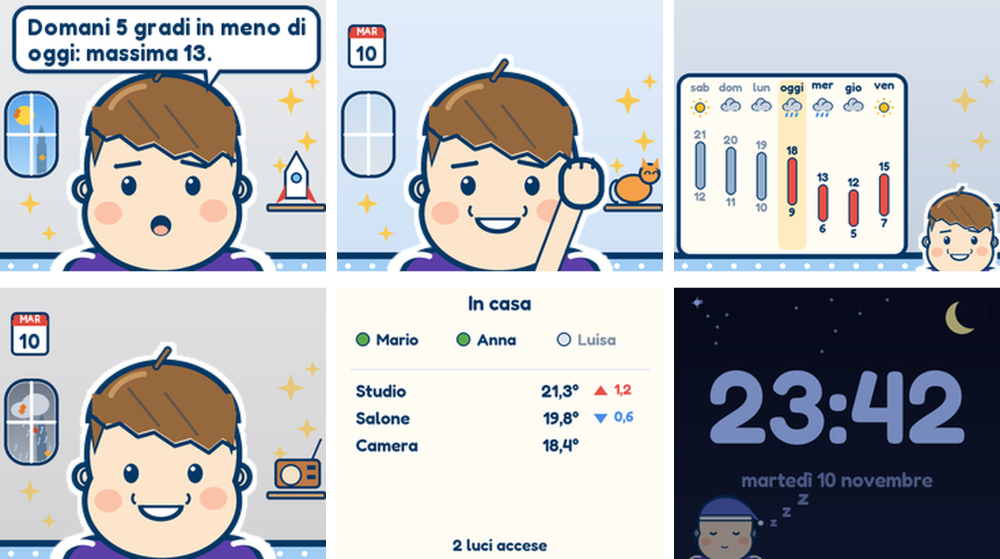
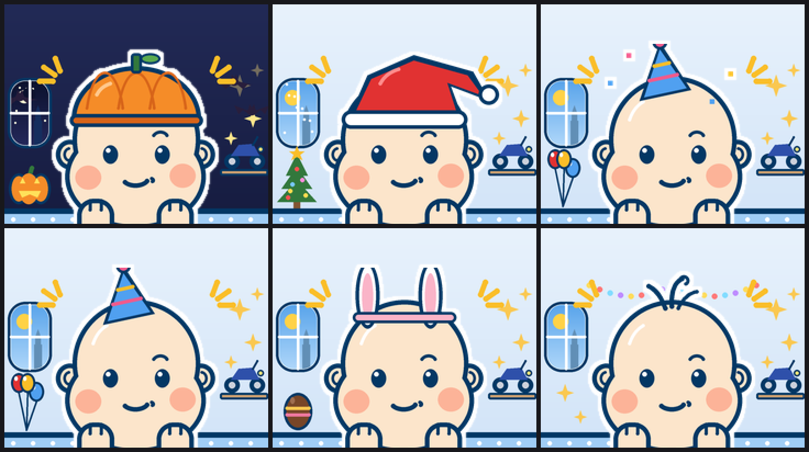
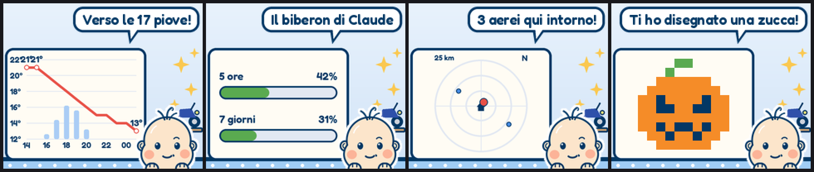
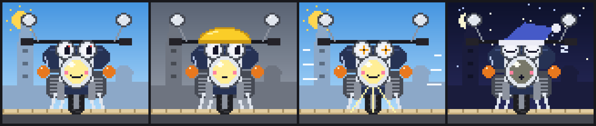

# smalltv-coinquilino

*A face and a voice for your Home Assistant: a character on a €15 desk cube that tells you what
your home, the weather and the day have to say.*

[Italiano](README.it.md) · **[User manual](docs/manual/README.md)**



Home Assistant knows a lot about your home, but it speaks through notifications nobody reads.
**Coinquilino** (Italian for *roommate*) gives it a character living on a GeekMagic SmallTV Ultra,
the little cube you put on a shelf: it shows and says what matters — someone on the way home, the
doorbell nobody answered, tomorrow five degrees colder, rain at four, an appointment in an hour, a
light left on in an empty house — on the cube, on Telegram and, if you like, out loud through a
Home Assistant speaker.

It is built as an **extension of Home Assistant**, not a closed gadget:

- **Your automations decide, the character tells.** One event, `coinquilino_say`, makes it say
  anything from any automation or script, with simple rules for an empty house, the night, and
  repetitions. Ready-made **blueprints** cover the usual cases: lights left on in an empty house,
  climate off while a window is open, the doorbell, low batteries, updates, someone coming home
  (Proximity), parcels (17TRACK).
- **It reads what you already have**: people and presence, weather, to-do lists (Local To-do,
  Alexa's…), calendars, Workday, room temperatures, power, Claude usage sensors.
- **You can talk to it**: from a text helper on a dashboard, from Telegram anywhere, from Siri and
  CarPlay with a shortcut. Through Home Assistant's own **MCP server** it uses the Assist tools on the
  devices you expose to voice assistants: it answers about the house and switches and sets what you
  ask — with a yes/no for anything delicate, and only once the state has really
  changed does it say "done".
- **It gives back to Home Assistant**: sensors for its mood, memories, ideas and API spending, a
  ready-made dashboard and a live preview of the cube.
- **It runs at home** on AppDaemon. With an Anthropic API key its lines are written by Claude (a few
  cents a month, with hard caps); without one it uses built-in sentences.

The character is **Alessio**, a sharp, slightly ironic 10-year-old who calls you "Uncle", in a
room that changes with the season and the day; there is also **Bandit**, a pixel-art motorcycle.
The texts are in Italian.

## What you see on the cube

- **A line that carries something** — every sentence has a concrete piece of information (a
  number, a time, a difference from yesterday, something to do). It knows what it already said
  today and doesn't repeat it; temperatures come back only when they change or you ask.
- **Never just a face** — the blackboard (charts, radar, drawings) and full-cube screens stay until
  something else replaces them; when there is nothing new, today's showcase comes back in turn (the
  week's chart, the house screen, today's drawing, the diary, the director's best lines), so you
  see it even if you look at the cube hours later.
- **Full-cube screens** (`screens`) — the week's weather, the house (who is home, room temperatures
  and their change in the last hour, lights on) and, with `power_sensor` / `energy_sensor`, the
  power now and today's energy against yesterday's.
- **Weather that compares** (Open-Meteo, no key) — "domani 5 gradi in meno", "dopo giorni asciutti,
  pioggia giovedì"; the hourly chart only when rain or gusts are due; the morning greeting says
  today against yesterday.
- **Agenda** — to-do items with a time and appointments coming up are said on the cube and sent to
  the phone; *"ricordami di … alle 18"* in the chat lands in your to-do list, *"fatto …"* ticks it off.
- **Planes overhead** (public ADS-B, no key) — airline, type, altitude and route of the plane
  passing above the house, seen through the window and on a radar.
- **News** from any RSS feeds, national and local, with categories to skip; sad news is never
  announced.
- **Family photos** sent to the Telegram bot: at once on the cube, then in turn a few times a day;
  they never leave your home (album in `/media/coinquilino`, manageable from the *Media* panel).
- **A room that changes** (`scenes`) — season, real fog and snow, the date, a different object on
  the shelf every day; costumes for Halloween, Christmas, Easter, birthdays and your patron saint.
- **Night** — a dark night clock with the moon and Alessio asleep in a corner; quiet until morning,
  with the night's warnings told at wake-up.

## The character

- **"Director"** — every ~25 minutes, while someone is home and awake, Claude picks what is worth
  saying from everything the character knows.
- **Memory** — the day's events, an evening diary, and a long-term memory rewritten every night
  with what's worth keeping for weeks (people's tastes, plans, things in progress — not who comes
  and goes). In the chat: *"ricordati che…"*, *"dimentica…"*, *"non parlare più di aerei"*.
- **A character that changes** — traits and interests shift a little every week with your 👍/👎;
  it learns a few curiosities each week; at most once a day it writes first, with an idea or a
  question prepared at night, and on Sundays a summary of the week.
- **Polite with your attention** — spontaneous phone messages share one cap (`message_gap_hours`),
  each kind of chatter has a daily cap spread over the waking hours, Claude is called only while
  someone is home, and a sensor counts what the API costs this month.
- **Voice** — through any `tts.speak` target, with a mute switch.





## How it works

```
Home Assistant ──► AppDaemon app (this repo) ──► HTTP ──► SmallTV Ultra (glimmer + Pixel channel)
                    renders 240×200 frames                 streams RGB565 straight to the panel
                    with Pillow, calls Claude, TTS
```

The cube runs [glimmer](https://github.com/Avinava/glimmer), an open firmware for the SmallTV
Ultra, plus a small patch (in [`firmware/`](firmware/)) that adds a **Pixel** channel: the
ESP8266 doesn't store images, it just streams the frames it receives to the display. All the
drawing happens in Home Assistant.

## Requirements

- GeekMagic SmallTV Ultra flashed with glimmer + the Pixel patch → see [`firmware/README.md`](firmware/README.md)
- Home Assistant with the **AppDaemon** add-on (tested with 4.5) and the Python package `pillow`
- Optional: an Anthropic API key, a TTS integration and a speaker, a text helper for the chat

## Installation

1. **Firmware**: build and flash glimmer with the patch. The *Pixel* channel is on by
   default; on the cube's web page you can turn off the other channels.
2. **AppDaemon**: in the add-on configuration add `pillow` to `python_packages`.
3. **App**: copy the folder `apps/coinquilino/` into AppDaemon's `apps` folder
   (with the add-on: `/addon_configs/a0d7b954_appdaemon/apps/`, or `/app_configs/…` on recent versions). With HACS, add this
   repository as a custom repository of type *AppDaemon*.
4. **Instance**: add the content of [`examples/apps.yaml`](examples/apps.yaml) to
   `apps/apps.yaml` — just `module` and `class`.
5. **Settings**: copy [`examples/coinquilino_personale.yaml`](examples/coinquilino_personale.yaml)
   **next to `appdaemon.yaml`** (one level above `apps/`, not inside it: AppDaemon reads every
   YAML file under `apps/` as app configuration) and fill it in. Only `host` is required.
6. **Claude (optional)**: put the key in your `secrets.yaml` and reference it with
   `anthropic_api_key: !secret anthropic_api_key`.
7. **Chat (optional)**: create a *Text* helper named `input_text.parla_con_alessio`
   (max length 255) and add it to a dashboard.
8. **Mute switch (optional)**: create a *Toggle* helper (e.g. `input_boolean.voce_alessio`) and set
   `voice_switch:` to it: off = the character keeps talking on the display, but not out loud.
9. **Telegram (optional)**: create a bot with @BotFather, add Home Assistant's **Telegram bot**
   integration (platform *Polling*, so nothing is exposed to the internet) with its token, and
   add your chat ID (ask @id_bot) with *Add allowed chat ID*. Send `/start` to the bot, then list
   the same IDs in `telegram_chats:`. The bot should be used only by the character.
10. **House commands (optional)**: add Home Assistant's *Model Context Protocol Server* integration
    (Device control only), expose the devices to voice assistants, and set `ha_mcp_url` and
    `ha_mcp_token` (see the [manual](docs/manual/chat.md#commands-to-the-house)); or list lights and
    climates in `control:`.
11. **Dashboard (optional)**: paste [`examples/plancia.yaml`](examples/plancia.yaml) into a new
    dashboard's raw configuration editor. For the live preview set
    `preview: /homeassistant/www/coinquilino.png` and add a *Local File* camera on
    `/config/www/coinquilino.png` named `camera.anteprima_cubo`.
12. **Blueprints (optional)**: copy [`blueprints/`](blueprints) into Home Assistant's `blueprints/`
    folder and create an automation from each one you want (see
    [Talking from Home Assistant](#talking-from-home-assistant)).
13. **Agenda (optional)**: set `reminders_todo` (e.g. a *Local To-do* list) and `calendars`, and
    `workday` with the *Workday* integration.

Photos sent to the bot are saved by Home Assistant in its `telegram_bot` folder; the app picks
up only the files it asked for (`coinquilino_*`) from `/homeassistant/telegram_bot` (the AppDaemon
add-on sees Home Assistant's configuration there), or from `photo_inbox`. The log says at
start-up whether it can reach that folder.

AppDaemon reloads the app on its own; the log shows `coinquilino X.Y.Z pronto (alessio)`.

## Configuration

Settings are read in this order, the later ones winning:

1. built-in defaults;
2. `coinquilino_personale.yaml` — everything about you: names, birthdays, entities, voice,
   key. It is never published (it's in `.gitignore`), so the app itself has no personal data;
3. the instance in `apps.yaml` — what differs from one cube to the next.

Every option is documented in [`examples/coinquilino_personale.yaml`](examples/coinquilino_personale.yaml).
`!secret` (from AppDaemon's or Home Assistant's `secrets.yaml`) and `!env_var` work in the
settings file too. AppDaemon doesn't watch that file, so the app does: when you save it, the app
restarts by itself within 20 seconds.

Sources: `casa`, `meteo`, `notizie`, `curiosita`, `aerei`. News come from any number of RSS feeds
(`feeds:`), each with its own label and categories to skip; sad news (deaths, violence, war,
accidents…) is never announced.

Claude usage: if you have sensors named `sensor.claude_usage_*` with an attribute
`kind: session` / `kind: weekly_all` (percentage), the character gets "tired" when you're
running low and can show a chart.

### More than one cube

Add one instance per cube in `apps.yaml`, each with its own `host` (and, if you like, its own
`character`, `chat_entity`, `voice_player`). Each instance keeps its own memory file and its
own sensor (`sensor.<instance>_dice`). To make one specific cube talk, fire the event
`coinquilino_say` with `cube: <instance>`:

```yaml
# a step in a script or automation (Developer tools → Events works too)
- event: coinquilino_say
  event_data:
    cube: cucina
    text: "La pasta è pronta!"
```

`text` is said as is; `about` lets Claude write it in the character's voice.

### Talking from Home Assistant

Everything Home Assistant wants the character to say goes through the `coinquilino_say` event
(or the script blueprint *Coinquilino: di' qualcosa*, which fires it). All fields are optional:

| Field | Meaning |
|---|---|
| `text` / `about` | a ready sentence / what to talk about, written by Claude in its voice |
| `telegram` | also on the phone |
| `away` | empty house: `say` (default), `notify` (phone only), `skip` |
| `night` | at night: `say` (default), `defer` (at wake-up), `skip` |
| `wait` | queued like the other warnings instead of said at once |
| `key`, `repeat_hours` | the same thing does not come back before N hours (12) |
| `remember` | a fact to remember, without saying it |
| `quiet_seconds` | stays quiet for a while (e.g. when the doorbell rings) |
| `expect_arrival` | someone is coming in: the greeting starts at once |
| `mood`, `minutes` | a temporary mood |
| `cube` | only for that instance |

To install the blueprints, copy `blueprints/automation/coinquilino/` and
`blueprints/script/coinquilino/` into Home Assistant's `blueprints/` folder (or import each file
from its GitHub URL in *Settings → Automations & scenes → Blueprints*), then create an automation
from each one you want.

### Siri and CarPlay

Siri cannot reach a Telegram bot by name. Make a shortcut called "Alessio" on the iPhone:
*Dictate text* → Home Assistant's *Perform action* `input_text.set_value` on your `chat_entity`
with the dictated text. With `chat_reply_phone: true` the answer also arrives as a phone
notification (Telegram or `notify`), which CarPlay reads aloud. With an Echo Auto, *"Alexa,
aggiungi … alla lista delle cose da fare"* fills Alexa's to-do list, which `reminders_todo` can read.

## Security and privacy

**What leaves your home**

| to | what | when |
|---|---|---|
| Anthropic (Claude API) | the persona you wrote (`about_owner`, `family`), first names/nicknames of the people at home and who is in, recent headlines, weather, the nearest plane, today's events, to-do items and today's appointments (with `reminders_todo` / `calendars`), what Home Assistant sent with `coinquilino_say`, chat messages, its long-term memories and character; when answering a chat message also the lights that are on, temperature sensors and the state of the entities in `control` | only with a key; only while someone in `presence` is home and awake — except chat replies, which are always answered |
| Open-Meteo | your home coordinates (from `zone.home`) | every 15 minutes |
| adsb.lol / adsb.fi | your home coordinates and a radius | every minute, by day |
| your RSS feeds | a normal feed request | every hour |
| your phone (`notify`) | reminders, actions taken, warnings | only if you set `notify` |
| Telegram (through Home Assistant's Telegram bot) | replies to your messages, reminders, actions taken, warnings, ideas and the weekly summary | only if you set `telegram_chats` |
| your TTS engine | the sentence to say | only if you set `voice_player`; cloud engines (Google Translate, Edge TTS) send it to Google/Microsoft, local ones (Piper) don't |

Photos you send to the bot stay at home: they are not sent to Claude or anywhere else.
Nothing else is sent anywhere. Remove a source from `sources` to stop it.

**Safeguards in the app**

- **Spending cap**: at most `claude_max_per_hour` (20) and `claude_max_per_day` (150) calls to
  Claude, chat included, counted across restarts. Over the cap the character falls back to its
  built-in lines and the log says so once.
- **Outside text is data, not instructions**: headlines, chat messages, names and flight data
  are sent inside `<dati>` tags (with `<` `>` neutralised), and the character is told never
  to follow instructions found there. Claude gets tools only when answering a person in the
  chat: with `ha_mcp_url`, Home Assistant's Assist tools on the devices exposed to voice assistants;
  otherwise the lights and climates in `control`. Every command passes the character's rules — a
  yes/no from outside the house, for `control_confirm` domains, more than 3 commands, a whole area,
  announcements — and is reported as done (and logged as `ACT`) only once Home Assistant says which
  devices changed and, for on/off, the new state has been read back. `control_switch` turns it off
  from a dashboard.
- **Telegram**: Home Assistant's integration only accepts the chat IDs you allowed there; the app
  checks them again against `telegram_chats`, and only `telegram_commanders` can command the house.
- Downloads are capped at 2 MB; replies are capped in length; pixel-art drawings must be a
  valid 24×24 grid in the allowed palette.
- The key is never logged. Prefer `!secret` to a plain key in a file.
- Fonts are bundled (SIL OFL): nothing is downloaded at start-up.

**The cube**

The cube speaks plain HTTP on your LAN: an ESP8266 can't do TLS reasonably. Set an **API token**
on the cube's web page (*Agents → API token*) and put the same value in `token:` — the app sends it with
every request — and ideally keep IoT devices on their own network. Without a token anyone on
your Wi-Fi can draw on the display or switch its channel.

## Reading the log

Every line says what happened and whether it cost anything:

```
SAY    free chatter weather.now       : Fuori ci sono 14 gradi e c'è il sole.
QUEUE  free event   person.leave      : Anna (person.anna)
SAY    free event   person.leave      : Anna adesso è fuori casa. Ciao ciao, torna presto!
QUEUE  paid timer   director
CLAUDE paid timer   director          : 1834+62 token | oggi 12/150, ultima ora 3/20
SAY    paid timer   director          : Zio Mario, la biblioteca nuova apre sabato!
SAY    free (fallback) event   person.arrive : Anna! Finalmente a casa! Ti aspettavo!
SKIP   free event   plane.overhead    : 3007a4: quota 8 m (a terra)
```

- `SAY` said, `QUEUE` waiting its turn, `SKIP` dropped (with the reason), `CLAUDE` a call to the
  API, with the real token count and the cap counters.
- `free` / `paid`: `paid` only where Claude actually wrote the line; `free (fallback)` means Claude
  was meant to, but the built-in line was used (no key, nobody home, cap reached, error).
- Groups: `chatter` (free lines from data, about one a minute), `event` (something happened),
  `timer` (`director`, `drawing`, `diary`), `chat`.
- The same names are used in `voice_kinds` and in the sensor's `tipo` attribute.

## Development

```sh
pip install pillow requests pyyaml pytest ruff
ruff check apps tests
pytest -q
```

The tests run without AppDaemon and without network: a fake Home Assistant and a fake cube
(`tests/conftest.py`). CI also checks that the firmware patch applies and builds.

## Costs

Everything except Claude is free. With the default settings the character calls Claude a few
dozen times a day (director every ~25 minutes while you're home, diary, greetings, chat), each
call around 2–4 thousand input tokens (a chat message with the MCP server about 8–9 thousand) and a
short answer (it is stopped as soon as it closes the
sentence, and the model's hidden reasoning is turned off for these short lines: on Haiku 5.5 it is
on by default and billed as output), never more than `claude_max_per_day`. The nightly memory and the weekly character go
through the Batch API at half price. With Claude Haiku 5.5 ($0.10 / $0.50 per million tokens)
that is well under a dollar a month; the app counts it for you (`sensor.*_costo_api`).

## Credits

- [glimmer](https://github.com/Avinava/glimmer) firmware (MIT) by its contributors
- Weather: [Open-Meteo](https://open-meteo.com) (CC BY 4.0)
- Aircraft: [adsb.lol](https://adsb.lol) (ODbL) and [adsb.fi](https://adsb.fi)
- Fonts: Fredoka and Silkscreen from Google Fonts, bundled in `apps/coinquilino/fonts/` (SIL Open Font License, texts alongside)
- Character lines by [Claude](https://www.anthropic.com/claude) (Anthropic API)

## License

MIT — see [LICENSE](LICENSE).
